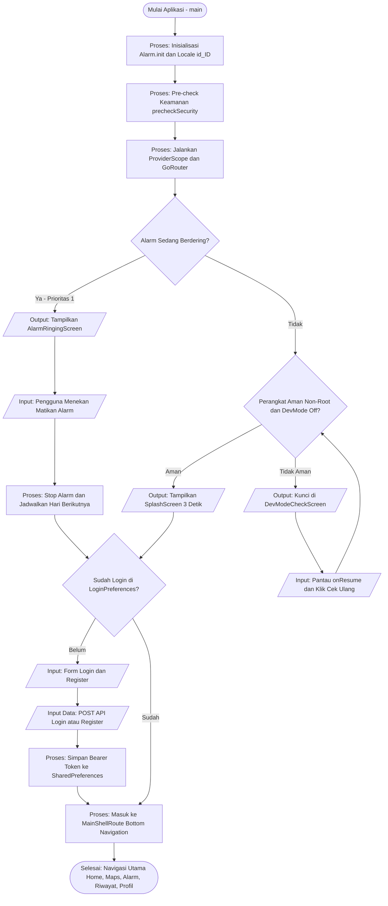
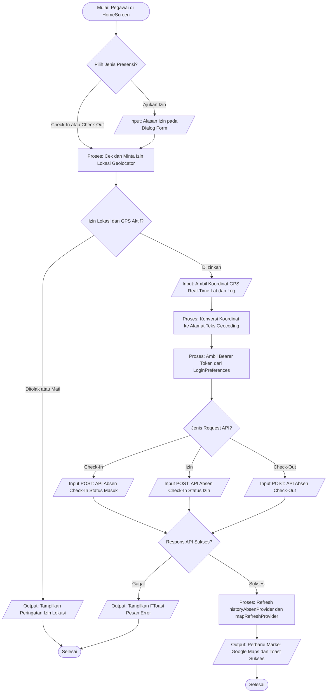
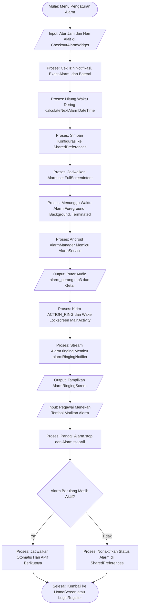

<div align="center">

# 📍 Absensi Manager Kopdes (`absensi_kopdes`)

**Aplikasi Mobile Manajemen Presensi Digital Pegawai Koperasi Desa (KopDes) Berbasis Flutter**

[](https://flutter.dev)
[](https://dart.dev)
[](https://riverpod.dev)
[](https://pub.dev/packages/go_router)
[-18181B?style=for-the-badge)](https://forui.dev)
[](https://pub.dev/packages/retrofit)
[](https://developer.android.com)

</div>

---

## 📖 Deskripsi Singkat

**Absensi Manager Kopdes** (`absensi_kopdes`) adalah aplikasi mobile berbasis Flutter yang dirancang khusus untuk memodernisasi dan mengamankan proses pencatatan kehadiran pegawai Koperasi Desa (KopDes). Aplikasi ini mengintegrasikan sistem presensi berbasis geolokasi (**Check-In**, **Check-Out**, dan pengajuan **Izin**), pemetaan lokasi interaktif secara *real-time* menggunakan **Google Maps**, sistem proteksi berlapis terhadap manipulasi perangkat (**Deteksi Root/Jailbreak & Mode Pengembang**), serta fitur **Pengingat Alarm Otomatis** yang tetap bekerja meskipun aplikasi ditutup total (*terminated state*).

---

## 📋 Daftar Isi

1. [Fitur Utama Aplikasi](#-fitur-utama-aplikasi)
2. [Alur Kerja Aplikasi (Flowchart)](#-alur-kerja-aplikasi-flowchart)
3. [Arsitektur & Tech Stack](#-arsitektur--tech-stack)
4. [Daftar Endpoint API](#-daftar-endpoint-api)
5. [Struktur Proyek (Project Structure)](#-struktur-proyek-project-structure)
6. [Instruksi Instalasi & Menjalankan Proyek](#-instruksi-instalasi--menjalankan-proyek)
7. [Konfigurasi Tambahan (Android Manifest & Permissions)](#-konfigurasi-tambahan-android-manifest--permissions)
8. [Panduan Pengujian pada Perangkat Fisik (OEM)](#-panduan-pengujian-pada-perangkat-fisik-oem)

---

## ✨ Fitur Utama Aplikasi

### 1. 🔐 Autentikasi & Manajemen Sesi
- **Login & Registrasi Tervalidasi**: Formulir autentikasi dibangun menggunakan `flutter_form_builder` dan `form_builder_validators` dengan validasi ketat untuk email, kata sandi, dan nama pengguna.
- **Manajemen Token Persisten**: Menyimpan status autentikasi dan *Bearer Token* secara aman dan *asynchronous* menggunakan `SharedPreferencesAsync` melalui service `LoginPreferences`.
- **Auto-Redirect Sesi**: Mengarahkan pengguna secara cerdas ke halaman utama (`HomeScreen`) apabila sesi masih aktif, atau ke halaman `LoginRegister` apabila belum masuk.

### 2. 📍 Presensi & Lokasi GPS (*Check-In*, *Check-Out*, & *Izin*)
- **Akuisisi Koordinat Akurat**: Mengambil titik koordinat GPS (`latitude` dan `longitude`) perangkat secara *real-time* saat pegawai melakukan *Check-In*, *Check-Out*, maupun pengajuan *Izin* menggunakan `geolocator`.
- **Reverse Geocoding Otomatis**: Menerjemahkan titik koordinat GPS menjadi alamat teks lengkap (nama jalan, kecamatan, kota) secara otomatis menggunakan package `geocoding`.
- **Manajemen Riwayat Kehadiran**: Menampilkan daftar riwayat presensi yang dapat difilter berdasarkan bulan, melihat detail waktu & lokasi kehadiran, serta menghapus data presensi tertentu (`deletePresensi`).

### 3. 🗺️ Peta Interaktif (*Google Maps Real-Time*)
- **Visualisasi Presensi**: Menampilkan posisi pengguna saat ini serta *marker* titik lokasi *Check-In* dan *Check-Out* secara langsung melalui `HomeMapWidget` (pratinjau di beranda) dan `MapsScreen` (tampilan peta layar penuh).
- **Sinkronisasi Lokasi Reaktif**: Terintegrasi dengan Riverpod (`mapRefreshProvider` dan `selectedAttendanceProvider`) sehingga fokus kamera peta otomatis diperbarui ketika pengguna memilih riwayat kehadiran atau memperbarui presensi.

### 4. 🛡️ Sistem Keamanan Perangkat (*Device Security Gate*)
- **Pre-Check Security saat Startup**: Sebelum aplikasi merender UI (`main()`), sistem menjalankan `DevModeCheckScreen.precheckSecurity()` menggunakan package `developer_mode` untuk memverifikasi integritas perangkat.
- **Global Lifecycle Security Listener**: Dilengkapi `AppLifecycleListener` yang memantau status `onResume`. Jika pengguna mengaktifkan **Mode Pengembang (*Developer Options*)** atau menggunakan perangkat **Root / Jailbreak** saat aplikasi sedang berjalan di latar belakang, aplikasi secara instan mengunci navigasi dan memaksa pengguna ke layar peringatan `DevModeCheckScreen`.

### 5. ⏰ Pengingat Check-Out Berbasis Alarm (*Background & Terminated State*)
- **Integrasi `alarm` v5**: Menggunakan *Foreground Service* dan *Exact Alarm Manager* yang menjamin alarm berbunyi tepat waktu meskipun aplikasi di-*minimize* atau ditutup total (*swiped away / terminated*).
- **Full-Screen Intent di Atas Lockscreen**: Konfigurasi `androidFullScreenIntent: true` yang dipadukan dengan *native window flags* (`setShowWhenLocked` & `setTurnScreenOn`) memungkinkan layar `AlarmRingingScreen` menyala dan tampil otomatis di atas layar kunci (*lockscreen*).
- **Penjadwalan Hari Aktif Fleksibel**: Mendukung pengaturan jam pengingat dengan opsi hari aktif yang dapat disesuaikan (Hari Kerja Senin–Jumat, Akhir Pekan, atau Setiap Hari) dengan kalkulasi otomatis waktu alarm berikutnya (`calculateNextAlarmDateTime`).
- **Audio Kustom & Kontrol Penuh**: Memutar audio khusus (`assets/alarm/alarm_perang.mp3`) secara *looping* dengan getaran dan volume terukur hingga pengguna menekan tombol **Matikan Alarm**.

### 6. 👤 Manajemen Profil & Kustomisasi Tema
- **Pembaruan Profil**: Pegawai dapat melihat informasi akun dan mengubah nama profil secara langsung yang tersinkronisasi ke server API.
- **Video Avatar Interaktif**: Menampilkan avatar profil dinamis berbasis video menggunakan `video_player` (`assets/video/my_bini.mp4`).
- **Dukungan Tema Gelap & Terang (*Dark/Light Mode*)**: Mengadopsi desain sistem modern berbasis **Forui** (bergaya *Shadcn UI*) yang dapat diubah secara instan melalui `ThemeToggleSwitch` dan disimpan secara lokal melalui `PreferencesTheme`.

---

## 🔄 Alur Kerja Aplikasi (Flowchart)

Seluruh diagram alir di bawah ini disusun mengikuti **Konvensi Simbol Flowchart Standar (ISO 5807 / ANSI)**:
- **Terminator (`([Teks])` - Oval / Kapsul)**: Titik awal (*Start*) dan akhir (*End*) alur program.
- **Input / Output (`[/Teks/]` - Jajargenjang)**: Operasi masukan pengguna, pengiriman/penerimaan data jaringan (`POST` API, ambil GPS), serta keluaran tampilan layar/notifikasi.
- **Process (`[Teks]` - Persegi Panjang)**: Proses komputasi internal, validasi, penyimpanan, atau manipulasi state.
- **Decision (`{Teks}` - Belah Ketupat)**: Titik percabangan logika atau evaluasi kondisi (*Ya / Tidak*).

---

### 1. Flowchart Utama: Startup, Keamanan Perangkat, & Navigasi (`GoRouter`)
Diagram berikut menjelaskan bagaimana aplikasi menangani inisialisasi awal, intersepsi alarm saat *cold start* (*terminated state*), pemeriksaan keamanan perangkat (*Root / Developer Mode*), hingga autentikasi pengguna:



---

### 2. Flowchart Proses Presensi (*Check-In*, *Check-Out*, & *Pengajuan Izin*)
Diagram berikut menggambarkan alur pengambilan lokasi GPS presisi tinggi, *reverse geocoding*, hingga pengiriman input data kehadiran (`POST`) ke server REST API:



---

### 3. Flowchart Sistem Alarm Pengingat Check-Out (*Background & Terminated State*)
Diagram berikut menjelaskan mekanisme penjadwalan alarm hingga bagaimana sistem membangunkan layar di atas *lockscreen* saat aplikasi tertutup rapat (*terminated*):



---

## 🏗️ Arsitektur & Tech Stack

Proyek ini menerapkan pola arsitektur **Modular Layered Architecture** yang memisahkan lapisan tampilan (*Views & Widgets*), logika bisnis & manajemen state (*Controllers & Riverpod Providers*), lapisan data & layanan eksternal (*Services*), serta struktur model data (*Models*) dengan dukungan penuh **Code Generation**.

### Daftar Teknologi & Package Utama

| Kategori | Package / Teknologi | Versi | Deskripsi & Kegunaan |
| :--- | :--- | :---: | :--- |
| **Framework & SDK** | `flutter` / `dart` | `^3.13.1` | Kerangka kerja utama pengembangan aplikasi *cross-platform*. |
| **State Management** | `flutter_riverpod` & `hooks_riverpod` | `^3.4.3` | Manajemen state reaktif, *dependency injection*, dan *caching* state asinkron. |
| **Code Gen (State)** | `riverpod_annotation` & `riverpod_generator` | `^4.0.7` | Generator provider menggunakan anotasi `@riverpod`. |
| **Routing** | `go_router` & `go_router_builder` | `^18.0.1` | Navigasi deklaratif berbasis *Strongly-Typed Routes* (`@TypedGoRoute`, `@TypedStatefulShellRoute`). |
| **UI Design System** | `forui` & `material_ui` | `^0.27.1` | Komponen UI modern bergaya *Shadcn UI* untuk Flutter beserta integrasi tema Material. |
| **HTTP & REST API** | `dio` & `retrofit` | `^5.11.1` / `^4.10.0` | *HTTP Client* dan deklarasi *type-safe REST API client*. |
| **JSON Serialization** | `json_annotation` & `json_serializable` | `^4.10.0` | Konversi otomatis objek Dart dari/ke JSON (`fromJson` / `toJson`). |
| **Peta & Geolokasi** | `google_maps_flutter`, `geolocator`, `geocoding` | `^2.18.2` / `^14.1.0` | Render peta Google Maps, pengambilan titik GPS akurat, dan *reverse geocoding*. |
| **Sistem Alarm** | `alarm` | `^5.13.3` | Penjadwalan alarm native Android/iOS dengan *Foreground Service* & *Full-Screen Intent*. |
| **Keamanan Perangkat** | `developer_mode` | `^0.0.2` | Deteksi status *Developer Mode* (USB Debugging) dan *Root/Jailbreak*. |
| **Form & Validasi** | `flutter_form_builder` & `form_builder_validators` | `^11.0.0` | Pembuatan formulir input dan aturan validasi field autentikasi. |
| **Manajemen Izin** | `permission_handler` | `^13.0.2` | Permintaan izin runtime (Lokasi, Notifikasi, Exact Alarm, Optimasi Baterai). |
| **Penyimpanan Lokal** | `shared_preferences` | `^2.5.5` | Penyimpanan lokal *key-value* untuk token autentikasi, tema, dan jadwal alarm. |
| **Multimedia & Jam** | `video_player`, `one_clock`, `animated_text_kit` | `^2.14.0` | Pemutar video profil, jam digital/analog *real-time*, dan animasi teks. |

---

## 🌐 Daftar Endpoint API

Aplikasi berkomunikasi dengan backend REST API menggunakan `Dio` dan `Retrofit` melalui konfigurasi pada [`lib/absensi/services/api_services.dart`](lib/absensi/services/api_services.dart):

- **Base URL**: `https://absensib1.mobileprojp.com`

| Method | Endpoint | Header Auth | Deskripsi |
| :---: | :--- | :---: | :--- |
| `POST` | `/api/register` | ❌ | Mendaftarkan akun pegawai baru (`RegisterRequestModel`). |
| `POST` | `/api/login` | ❌ | Autentikasi pengguna dan mendapatkan *Bearer Token* (`LoginRequestModel`). |
| `GET` | `/api/absen/history` | ✅ Bearer | Mengambil daftar seluruh riwayat presensi pengguna. |
| `POST` | `/api/absen/check-in` | ✅ Bearer | Mengirim data presensi masuk (*Check-In*) atau pengajuan *Izin* beserta koordinat & alamat. |
| `POST` | `/api/absen/check-out` | ✅ Bearer | Mengirim data presensi pulang (*Check-Out*) beserta koordinat & alamat lokasi. |
| `DELETE` | `/api/absen/{id}` | ✅ Bearer | Menghapus data riwayat presensi berdasarkan ID presensi. |
| `GET` | `/api/profile` | ✅ Bearer | Mengambil data profil pegawai yang sedang login. |
| `PUT` | `/api/profile` | ✅ Bearer | Memperbarui nama lengkap pada profil pegawai (`NameUserEditRequestModel`). |

---

## 📂 Struktur Proyek (Project Structure)

Berikut adalah pemetaan arsitektur direktori di dalam proyek ini:

```text
absensi_dede/
├── android/                                # Konfigurasi spesifik platform Android
│   └── app/src/main/
│       ├── AndroidManifest.xml             # Deklarasi permissions, Google Maps API Key, & Intent Filter Alarm
│       └── kotlin/.../MainActivity.kt      # Konfigurasi native showOverLockscreen & turnScreenOn
├── assets/                                 # Aset statis aplikasi
│   ├── alarm/alarm_perang.mp3              # Audio kustom untuk dering alarm check-out
│   ├── fonts/Montserrat/                   # Font kustom keluarga Montserrat
│   ├── images/                             # Logo, gambar splash screen, dan aset visual
│   └── video/my_bini.mp4                   # Video avatar pada halaman profil
├── lib/
│   ├── _constants/
│   │   └── months.dart                     # Konstanta daftar nama bulan dalam Bahasa Indonesia
│   ├── helper/
│   │   ├── date_formatter.dart             # Utilitas pemformatan tanggal dan waktu lokal (id_ID)
│   │   └── greetings.dart                  # Helper sapaan waktu dinamis (Pagi, Siang, Sore, Malam)
│   ├── theme/
│   │   ├── colors.dart                     # Palet warna sistem
│   │   ├── icons.dart                      # Definisi ikon kustom
│   │   ├── style.dart                      # Konfigurasi gaya komponen
│   │   ├── theme.dart                      # Konfigurasi LightTheme & DarkTheme Forui
│   │   └── typography.dart                 # Pengaturan tipografi teks
│   ├── absensi/                            # Modul utama fitur Absensi
│   │   ├── controllers/                    # Riverpod AsyncNotifier / Notifier (Business Logic)
│   │   │   ├── check_in_user.dart          # Controller proses Check-In
│   │   │   ├── check_out_user.dart         # Controller proses Check-Out
│   │   │   ├── delete_presensi.dart        # Controller penghapusan presensi
│   │   │   ├── edit_profile.dart           # Controller ubah nama profil
│   │   │   ├── history_absen.dart          # Controller pengambilan & state riwayat absen
│   │   │   ├── izin_user.dart              # Controller pengajuan izin tidak hadir
│   │   │   ├── login_user.dart             # Controller autentikasi login
│   │   │   ├── profile_user.dart           # Controller pemuatan profil pengguna
│   │   │   └── register_user.dart          # Controller pendaftaran akun baru
│   │   ├── models/                         # Data Models & JSON Serialization (.g.dart)
│   │   │   ├── absen/                      # Model request/response Check-In, Check-Out, Izin, & History
│   │   │   ├── login/                      # Model request, response, & error Login
│   │   │   ├── register/                   # Model request, response, & error Register
│   │   │   └── user/                       # Model profil pengguna & edit nama
│   │   ├── riverpod/                       # State Providers UI & Global State
│   │   │   ├── bottom_nav.dart             # State indeks navigasi bawah
│   │   │   ├── map_refresh.dart            # Trigger pembaruan peta Google Maps
│   │   │   ├── selected_attendance.dart    # State item presensi yang dipilih untuk ditampilkan di peta
│   │   │   ├── theme.dart                  # Provider state Dark/Light mode
│   │   │   └── user_riverpod.dart          # Provider data pengguna aktif
│   │   ├── router/
│   │   │   ├── routes.dart                 # Definisi rute deklaratif GoRouter & ShellRoute
│   │   │   └── routes.g.dart               # File hasil generate go_router_builder
│   │   ├── services/                       # Lapisan komunikasi eksternal, penyimpanan, & izin
│   │   │   ├── alarm_preferences.dart      # Manajemen jadwal alarm & kalkulasi hari aktif
│   │   │   ├── api_services.dart           # Definisi endpoint Retrofit REST API
│   │   │   ├── app_permission_service.dart # Manajemen runtime permission & battery optimization
│   │   │   ├── dio_client.dart             # Konfigurasi instance Dio & interceptor
│   │   │   ├── login_preferences.dart      # Penyimpanan sesi login & Bearer Token
│   │   │   ├── maps_service.dart           # Layanan pengambilan GPS & Reverse Geocoding
│   │   │   └── preferences_theme.dart      # Penyimpanan preferensi tema gelap/terang
│   │   ├── views/                          # Halaman penuh aplikasi (Screens)
│   │   │   ├── alarm_ringing_screen.dart   # Layar saat alarm berdering (muncul di atas lockscreen)
│   │   │   ├── alarm_screen.dart           # Halaman manajemen pengingat alarm
│   │   │   ├── attendance_detail.dart      # Halaman daftar & riwayat detail presensi bulanan
│   │   │   ├── dev_mode_check_screen.dart  # Layar blokir keamanan (Root / Developer Mode aktif)
│   │   │   ├── home_screen.dart            # Halaman beranda utama (jam, aksi cepat, peta mini)
│   │   │   ├── login_register.dart         # Halaman autentikasi Login & Register
│   │   │   ├── maps_screen.dart            # Halaman peta Google Maps interaktif penuh
│   │   │   ├── profile_screen.dart         # Halaman profil pengguna & pengaturan aplikasi
│   │   │   ├── security_check_screen.dart  # Layar transisi pemeriksaan keamanan awal
│   │   │   └── splash_screen.dart          # Layar pembuka beranimasi (Splash Screen)
│   │   └── widgets/                        # Komponen UI modular yang dapat digunakan kembali
│   │       ├── bottom_nav_bar.dart         # Bilah navigasi bawah (Bottom Navigation Bar)
│   │       ├── button_about_us.dart        # Dialog informasi tentang aplikasi
│   │       ├── check_in_button.dart        # Tombol & dialog konfirmasi Check-In
│   │       ├── check_out_button.dart       # Tombol & dialog konfirmasi Check-Out
│   │       ├── checkout_alarm_widget.dart  # Kartu pengaturan jam & hari aktif alarm
│   │       ├── delete_presensi_button.dart # Tombol hapus riwayat presensi
│   │       ├── form_auth.dart              # Komponen form Login & Registrasi
│   │       ├── home_map_widget.dart        # Widget peta mini pada beranda
│   │       ├── izin_button.dart            # Tombol & dialog form pengajuan Izin
│   │       ├── logout_button.dart          # Tombol keluar sesi akun
│   │       └── theme_toggle_switch.dart    # Switch pengubah tema Gelap/Terang
│   └── main.dart                           # Entrypoint utama, inisialisasi Alarm, Security, & GoRouter
└── pubspec.yaml                            # Konfigurasi dependencies, font, dan aset proyek
```

---

## 🚀 Instruksi Instalasi & Menjalankan Proyek

Ikuti langkah-langkah berikut untuk menyiapkan dan menjalankan proyek di lingkungan pengembangan lokal Anda:

### Prasyarat Sistem
- **Flutter SDK**: Versi terbaru yang mendukung **Dart SDK `^3.13.1`**
- **Java Development Kit (JDK)**: Versi **17** (dikonfigurasi pada `build.gradle.kts`)
- **Android SDK**: `compileSdk = 37`, `minSdk` minimal 23
- **Google Maps API Key**: Kunci API aktif dengan layanan *Maps SDK for Android* diaktifkan di Google Cloud Console.

---

### 1. Kloning Repository
```bash
git clone <URL_REPOSITORY_ANDA>
cd absensi_dede
```

### 2. Unduh Dependencies Package
Jalankan perintah berikut untuk mengunduh seluruh pustaka yang dibutuhkan di `pubspec.yaml`:
```bash
flutter pub get
```

### 3. Konfigurasi `local.properties` (Google Maps API Key)
Aplikasi ini membaca `GOOGLE_MAPS_API_KEY` dari file `android/local.properties` untuk diinjeksikan ke dalam `AndroidManifest.xml` melalui `manifestPlaceholders`.

Buka atau buat file **`android/local.properties`**, lalu tambahkan baris berikut:
```properties
sdk.dir=/path/to/your/android/sdk
flutter.sdk=/path/to/your/flutter/sdk
GOOGLE_MAPS_API_KEY=AIzaSyYourActualGoogleMapsApiKeyHere
```

### 4. Jalankan Code Generation (`build_runner`)
Proyek ini menggunakan generator kode untuk **Retrofit** (`api_services.g.dart`), **JsonSerializable** (`*.g.dart`), **Riverpod Generator**, dan **GoRouter Builder** (`routes.g.dart`). Jalankan perintah berikut untuk menghasilkan atau memperbarui seluruh file `.g.dart`:
```bash
dart run build_runner build --delete-conflicting-outputs
```
*(Opsional: Gunakan `dart run build_runner watch --delete-conflicting-outputs` jika ingin memantau perubahan kode secara otomatis saat pengembangan).*

### 5. Jalankan Aplikasi
Pastikan emulator atau perangkat fisik Android sudah terhubung (perhatikan bahwa pada perangkat fisik, **Mode Pengembang / Developer Options** akan memicu layar keamanan `DevModeCheckScreen` sesuai fitur keamanan aplikasi):
```bash
flutter run
```
Untuk membangun APK rilis (*Release Build*):
```bash
flutter build apk --release
```

---

## ⚙️ Konfigurasi Tambahan (Android Manifest & Permissions)

Agar seluruh fitur geolokasi dan alarm latar belakang berjalan dengan stabil, aplikasi mendeklarasikan sejumlah izin dan konfigurasi khusus di dalam [`android/app/src/main/AndroidManifest.xml`](android/app/src/main/AndroidManifest.xml) serta [`MainActivity.kt`](android/app/src/main/kotlin/com/example/absensi_dede/MainActivity.kt):

### 1. Daftar Izin (`uses-permission`)

| Izin Android (`AndroidManifest.xml`) | Fungsi & Kegunaan |
| :--- | :--- |
| `ACCESS_FINE_LOCATION` & `ACCESS_COARSE_LOCATION` | Mengambil titik koordinat GPS presisi tinggi saat melakukan Check-In, Check-Out, dan Izin. |
| `SCHEDULE_EXACT_ALARM` & `USE_EXACT_ALARM` | Menjamin alarm pengingat Check-Out dieksekusi pada detik yang presisi oleh sistem Android 12+. |
| `USE_FULL_SCREEN_INTENT` | Mengizinkan sistem meluncurkan `AlarmRingingScreen` secara layar penuh ketika perangkat terkunci. |
| `FOREGROUND_SERVICE` & `FOREGROUND_SERVICE_MEDIA_PLAYBACK` | Menjaga layanan pemutaran suara alarm (`AlarmService`) tetap berjalan meskipun aplikasi ditutup. |
| `POST_NOTIFICATIONS` & `ACCESS_NOTIFICATION_POLICY` | Menampilkan notifikasi alarm prioritas tinggi pada Android 13+ (API 33+). |
| `REQUEST_IGNORE_BATTERY_OPTIMIZATIONS` | Meminta pengecualian penghemat baterai (*Doze Mode*) agar jadwal alarm tidak dibekukan OS. |
| `WAKE_LOCK` & `VIBRATE` | Membangunkan CPU/layar perangkat dan mengaktifkan getaran saat waktu alarm tiba. |
| `RECEIVE_BOOT_COMPLETED` | Menjadwalkan ulang alarm secara otomatis apabila perangkat di-*restart* (reboot). |
| `SYSTEM_ALERT_WINDOW` | Izin overlay untuk mendukung penampilan antarmuka peringatan di atas aplikasi lain. |

### 2. Konfigurasi Lockscreen & Intent Filter (`MainActivity`)
Pada `AndroidManifest.xml`, `.MainActivity` dilengkapi dengan atribut:
- `android:showWhenLocked="true"` dan `android:turnScreenOn="true"`
- Intent filter khusus `<action android:name="com.gdelataillade.alarm.action.RING"/>` agar package `alarm` v5 mengenali `MainActivity` sebagai target utama peluncuran layar penuh.
- Pada sisi native Kotlin (`MainActivity.kt`), fungsi `showOverLockscreen()` memanggil `setShowWhenLocked(true)`, `setTurnScreenOn(true)`, dan `FLAG_KEEP_SCREEN_ON` secara programatik untuk memastikan layar menyala pada *cold start* (kondisi aplikasi mati total) di Android 8.1 hingga Android 15.

---

## 📱 Panduan Pengujian pada Perangkat Fisik (OEM)

1. **Pengujian Fitur Keamanan (`DevModeCheckScreen`)**:
   - Aplikasi secara aktif memblokir penggunaan apabila **Opsi Pengembang (*Developer Options*)** menyala. Untuk menguji alur penuh aplikasi pada perangkat fisik, bangun APK (`flutter install` atau `flutter build apk`) lalu **matikan Opsi Pengembang** di pengaturan HP Anda.
2. **Pengaturan Khusus Vendor Android (Xiaomi/MIUI/HyperOS, Oppo/ColorOS, Vivo, Realme)**:
   - Agar `AlarmRingingScreen` dapat muncul otomatis menembus *lockscreen* ketika aplikasi ditutup total (*terminated*), pastikan izin tambahan OEM berikut telah diaktifkan di **Pengaturan HP > Aplikasi > Absensi Kopdes > Perizinan Lainnya**:
     - ✅ **Tampilkan di Layar Kunci (*Show on Lock screen*)**
     - ✅ **Tampilkan jendela pop-up saat berjalan di latar belakang (*Display pop-up window while running in background*)**
     - ✅ **Mulai Otomatis (*Auto-start*)**

---

<div align="center">

Dikembangkan dengan ❤️ menggunakan **Flutter** untuk **Koperasi Desa (KopDes)**

</div>
